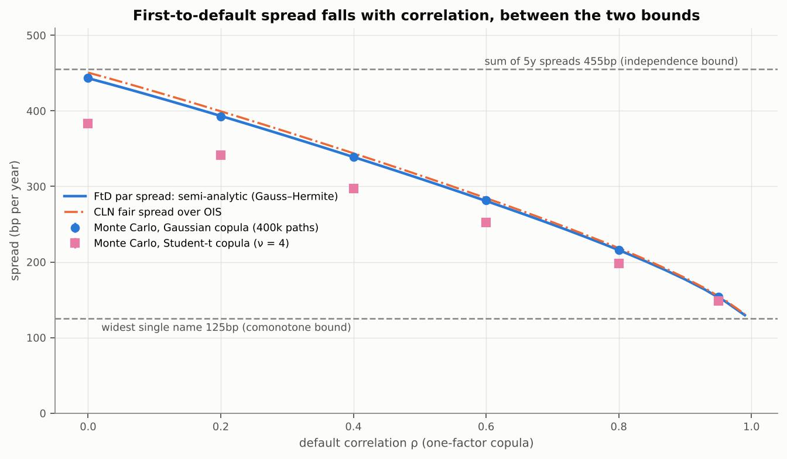
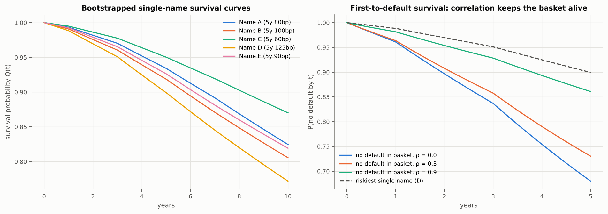
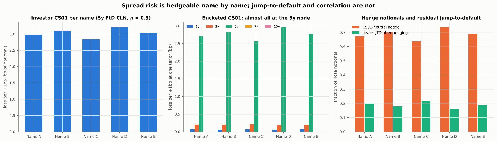
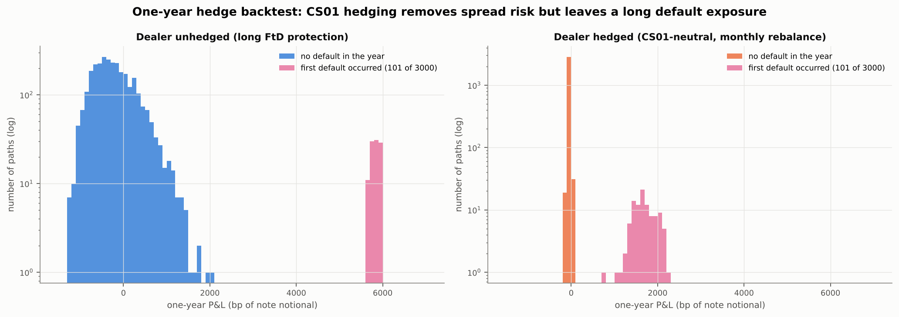

# credit-linked-note

**Pricing and hedging a 5-year funded first-to-default basket credit-linked note on five investment-grade names: ISDA-style CDS bootstrapping, Gaussian-copula basket pricing (semi-analytic and Monte Carlo), sensitivities and a hedge backtest.**

[](https://github.com/zakclaridge23/credit-linked-note/actions/workflows/ci.yml)




*The first-to-default spread falls from close to the sum of the five spreads (independent defaults) towards the widest single name (defaults together), so the note's investor is long correlation.*

> All market data here is **synthetic and illustrative**: spread curves, recoveries and the OIS curve are realistic in range but not real quotes.

## What this is

An investor buys a note from a bankruptcy-remote vehicle and earns OIS + 3.72% a year, five or six
times the spread of any single name in the basket, until the first of five companies defaults. Then the
note pays back only that company's recovery value (about 40%). In effect the investor has sold
first-to-default protection on the basket, in a funded, bond-like format. This project builds the pricing stack such a note needs:
single-name default curves bootstrapped from CDS quotes, a default-correlation model for the basket, the
note's fair coupon, its risks (spread, correlation, recovery, jump-to-default) and what a dealer can and
cannot hedge with single-name CDS.

## Key results

From `scripts/make_figures.py`; every number is in `figures/results.json`.

- **Correlation drives the price.** The FtD par spread is **443bp at ρ = 0**, close to the 455bp sum of
  the five 5y spreads, **367bp at ρ = 0.3**, and **130bp at ρ = 0.99**, approaching the widest name's
  125bp. A Student-t copula (4 degrees of freedom) is 30–60bp cheaper for ρ ≤ 0.6 because of tail dependence.
- **The note's fair spread is 372bp over OIS at ρ = 0.3**, slightly above the FtD swap's 367bp because
  the investor gets no accrued coupon at default.
- **Semi-analytic and Monte Carlo agree** within 1–2 standard errors at every ρ (e.g. 280.83bp vs
  281.19 ± 0.37bp at ρ = 0.6 with 2 million paths), once the quadrature is fixed: plain Gauss–Hermite
  was 12bp off at ρ = 0.99.
- **Risks per unit notional (investor):** CS01 of about −3bp per 1bp on each name (−15.1bp in total),
  Correl01 **+11.1bp** per +1% correlation, recovery −1% costs 1.9bp, jump-to-default −60% on any name.
- **CS01-neutral is not JTD-neutral.** The dealer sells 0.64–0.73 of 5y protection per name (3.4× notional
  in total) to be CS01-neutral, but stays long **0.16–0.22 of jump-to-default** per name, and correlation
  cannot be hedged with single-name CDS at all.
- **Hedge backtest (3,000 one-year paths, monthly rebalancing):** CS01 hedging cuts the P&L standard
  deviation in years without a default from **485bp to 18bp**, but the book still makes about
  **+1,700bp** of notional when a name defaults (vs +5,900bp unhedged). The hedged mean of +29bp is a model
  mismatch: the simulated market has no contagion, so survivors' hedges are unwound at unchanged spreads,
  whereas the copula prices the survivors as riskier after a default.

## How it works

- **CDS** (`src/cln/pricing/cds.py`): piecewise-constant hazards bootstrapped tenor by tenor; premium leg
  with accrual on default and protection leg integrated on a fine grid with flat forwards, as in the
  ISDA standard model. All inputs reprice to < 1e-4bp.
- **Basket** (`copula.py`, `montecarlo.py`): one-factor Gaussian copula, τᵢ = Qᵢ⁻¹(Φ(√ρ M + √(1−ρ) Zᵢ)).
  Conditional on M the names are independent, so the FtD survival is a one-dimensional integral
  (Gauss–Hermite, or a trapezoid rule for ρ > 0.9); Monte Carlo inverts cumulative hazards.
- **Note** (`note.py`): floating coupons, spread annuity, recovery leg and principal under the FtD survival curve;
  the fair spread makes the price par. A default-free note is exactly a par floater.
- **Hedging** (`src/cln/hedging/`): bump-and-reprice CS01 (by name and tenor), Correl01, recovery
  sensitivity, jump-to-default; and a backtest with correlated stochastic spreads and copula-correlated
  defaults.

The product, the maths (including why the FtD spread lies between the widest and the sum of the
spreads, via Slepian's inequality) and an illustrative term sheet are in
**[`notes/product.pdf`](notes/product.pdf)**. Modelling choices: [`docs/DESIGN_DECISIONS.md`](docs/DESIGN_DECISIONS.md).

## Quickstart

```bash
uv sync                  # Python 3.12
make test                # 22 tests, ~30 s
make figures             # all figures + results.json (~8 min on 4 cores; the backtest dominates)
make notes               # notes/product.pdf
```

```python
from cln.market import build_market
from cln.pricing.copula import ftd_spread
from cln.pricing.note import note_value

mk = build_market()
print(ftd_spread(mk.curves, mk.dc, 5.0, mk.recoveries, rho=0.3) * 1e4)            # 366.6 bp
print(note_value(mk.curves, mk.dc, 5.0, mk.recoveries, 0.3).fair_spread() * 1e4)  # 372.1 bp
```

## Results in detail


*Bootstrapped survival curves, and the basket's probability of no default: higher correlation keeps the basket alive longer.*


*Spread risk sits almost entirely at the 5y node and can be hedged name by name; what remains after hedging is a long jump-to-default position.*

| Name | 5y spread (bp) | CS01, investor (bp of notional per bp) | 5y CDS hedge notional (dealer sells) | Dealer JTD unhedged | Dealer JTD CS01-hedged |
|---|---|---|---|---|---|
| Name A | 80 | -2.97 | 0.671 | +0.600 | +0.197 |
| Name B | 100 | -3.08 | 0.702 | +0.600 | +0.179 |
| Name C | 60 | -2.84 | 0.637 | +0.600 | +0.218 |
| Name D | 125 | -3.20 | 0.734 | +0.600 | +0.159 |
| Name E | 90 | -3.03 | 0.687 | +0.600 | +0.188 |
| **Total** | | -15.13 | 3.431 | | |

Correl01 (investor, +1% correlation): +11.08bp of notional. Rec01 (investor, recovery −1%, spreads fixed): -1.88bp. JTD per unit notional; the dealer is long FtD protection.


*Hedging collapses the spread-driven P&L (orange) but not the default outcomes (pink), which stay large and positive for a dealer who is long first-to-default protection.*

## Project structure

```
src/cln/
  market.py            synthetic names, spread curves, OIS curve
  pricing/curves.py    piecewise-flat discount and hazard curves
  pricing/cds.py       CDS legs, par spread, upfront, bootstrap
  pricing/copula.py    Gaussian-copula FtD (semi-analytic)
  pricing/montecarlo.py  default-time simulation (Gaussian and Student-t copulas)
  pricing/note.py      CLN valuation and fair spread
  hedging/sensitivities.py  CS01 (by name and tenor), Correl01, Rec01, JTD, hedge notionals
  hedging/backtest.py  one-year hedge backtest
scripts/               make_figures.py
tests/                 CDS, copula, note, hedging, backtest, regression
notes/                 product.tex / product.pdf
docs/                  DESIGN_DECISIONS.md
```

## Validation

| What | Tested against | Result |
|---|---|---|
| Bootstrap | reprice every quote; random realistic curves (hypothesis) | < 1e-4bp; hazards > 0 |
| Flat-hazard CDS | closed-form protection leg; credit triangle | 1e-9 relative; < 1bp |
| Inconsistent quotes | must be rejected | ValueError |
| Standard coupon | upfront zero at the par spread; sign for 100bp/500bp coupons | pass |
| FtD at ρ = 0 | product of survivals; flat identical names: FtD hazard = sum | 1e-12 / 1e-6 |
| FtD at ρ → 1 | identical names: converges to the single-name spread | gap decreasing, < 0.5% at ρ = 1 |
| Bounds and monotonicity | widest ≤ FtD ≤ sum; strictly decreasing in ρ | pass |
| Quadrature | 32 vs 128 Gauss–Hermite nodes | 1e-8 |
| Monte Carlo | semi-analytic at ρ = 0, 0.3, 0.7, 0.95 | within 3.5 s.e. |
| Note | default-free note = par floater; fair spread prices at par; s* − FtD spread in (0, 15bp) | 1e-10 |
| Risk | signs; bucketed CS01 zero beyond 5y and sums to parallel; hedged JTD > 0 | pass |
| Backtest | zero-vol path = carry + time decay exactly; hedging halves spread P&L dispersion (at least) | pass |
| Regression | FtD spreads, fair spread, CS01, Correl01, hedge notionals | 0.01bp |

## Limitations and extensions

- Simplified CDS conventions (quarterly 0.25 accrual, no ACT/360, IMM dates or calendars); deterministic
  rates independent of defaults; constant recovery.
- One flat copula correlation; no base-correlation mapping to an index, no stochastic correlation.
- Issuer and collateral default ignored (an extension in the brief).
- Backtest dynamics are stylised and not derived from the pricing model; no contagion at default; cash
  undiscounted over the one-year horizon.
- Natural extensions: nth-to-default, collateral risk, hedging correlation with index tranches.

## References

- O'Kane, D. (2008). *Modelling Single-name and Multi-name Credit Derivatives*. Wiley.
- Li, D. X. (2000). On default correlation: a copula function approach. *Journal of Fixed Income* 9(4).
- Hull, J. and White, A. (2004). Valuation of a CDO and an nth to default CDS without Monte Carlo simulation. *Journal of Derivatives* 12(2).
- ISDA CDS Standard Model documentation (cdsmodel.com).
- Slepian, D. (1962). The one-sided barrier problem for Gaussian noise. *Bell System Technical Journal* 41(2).
